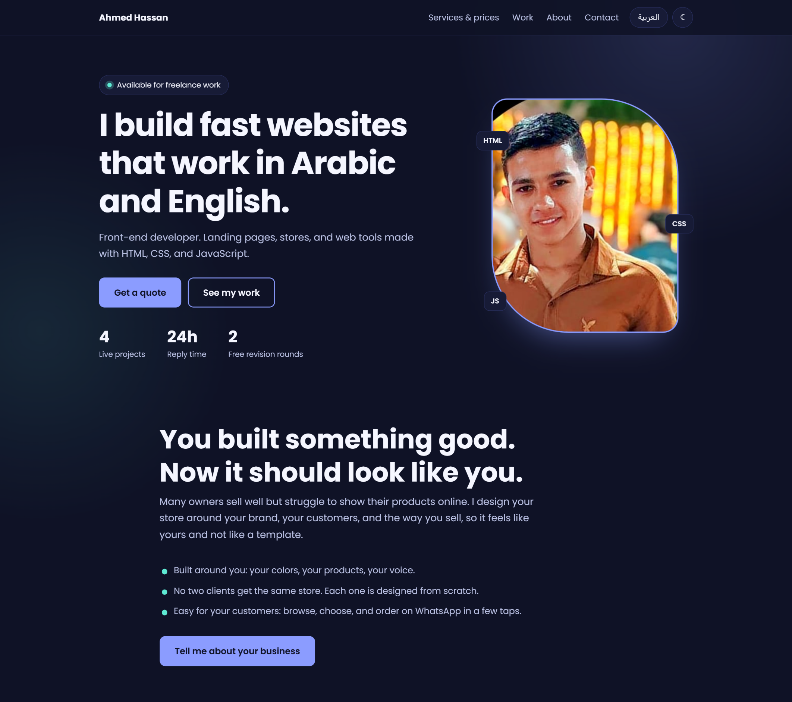

# Hi, I'm Ahmed Hassan 👋

**Front-End Developer** building fast, responsive websites and stores in Arabic and English

---

## 🧑‍💻 About Me

I build responsive websites, stores, and web tools with HTML, CSS, and JavaScript, and every interface I make works in both Arabic (RTL) and English. I started coding in 2026 and I publish what I build online. I'm currently learning **React** and **back-end development**.

🟢 **Available for freelance work:** landing pages, business websites, store front-ends, and converting Figma/PSD designs to clean code. Fixed-price packages are listed in my [portfolio](https://ahmedhassanhamed.github.io/AhmedHassanHamed/#services).

🇪🇬 **متاح لمشاريع العمل الحر:** صفحات هبوط، مواقع شركات، واجهات متاجر، وتحويل التصاميم إلى كود.

## 🚀 Featured Projects

| Project                          | What it is                                                                                  | Links                                                               |
| -------------------------------- | ------------------------------------------------------------------------------------------- | ------------------------------------------------------------------- |
| 🕯️ **Shamaet Nour Store**        | Bilingual storefront with search, filters, cart, wishlist, dark mode, and WhatsApp checkout | [Live demo](https://ahmedhassanhamed.github.io/Shamaet-Nour-Store/) |
| 📄 **CV Builder (AR/EN)**        | 7 templates, live preview, PDF and Word export, cover letter generator                      | [Live demo](https://ahmedhassanhamed.github.io/CV_Builder/)         |
| 🧾 **Invoice Generator (AR/EN)** | PDF/PNG export, WhatsApp sharing, dark mode, deposit calculator                             | [Live demo](https://ahmedhassanhamed.github.io/Invoice_Generator/)  |
| 💸 **Expense Tracker**           | Daily spending by category with progress bars, saved privately in the browser               | [Live demo](https://ahmedhassanhamed.github.io/expense-tracker/)    |

## 🛠️ Skills

  
  
  
  
  

**Also:** Responsive Design · RTL / LTR layouts · Accessibility basics · Bilingual (Arabic/English) interfaces

## 📚 Learning

- React
- Back-end development

## 🤝 Let's work together

| Platform      | Link                                                                               |
| ------------- | ---------------------------------------------------------------------------------- |
| 🌐 Portfolio  | [ahmedhassanhamed.github.io](https://ahmedhassanhamed.github.io/AhmedHassanHamed/) |
| 🛒 Khamsat    | [khamsat.com/user/hassanhamed_cz](https://khamsat.com/user/hassanhamed_cz)         |
| 💼 Mostaql    | [mostaql.com/u/Ahmed_Hassan_CZ](https://mostaql.com/u/Ahmed_Hassan_CZ)             |
| 🧑‍💻 Upwork     | [Upwork profile](https://www.upwork.com/freelancers/~017e71c52f4947b2a6)           |
| 🌍 Freelancer | [freelancer.com/u/hassanhamed3](https://www.freelancer.com/u/hassanhamed3)         |
| 🎯 Fiverr     | [Fiverr profile](https://www.fiverr.com/s/ZooZpjQ)                                 |
| 💬 WhatsApp   | [Message me](https://wa.me/201147729020)                                           |
| ✉️ Email      | [ahmed.hassan.dev77@gmail.com](mailto:ahmed.hassan.dev77@gmail.com)                |

⭐ Thanks for stopping by.

